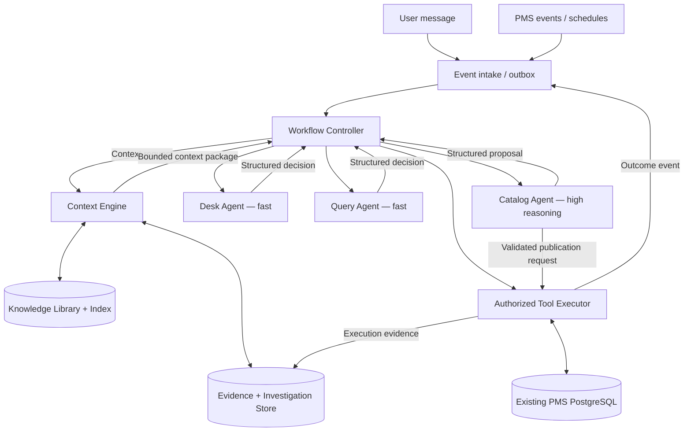

# LEON — Context Engine and Agentic Architecture

**Status:** Proposed architecture / implementation blueprint  
**Scope:** AI layer extending LEON's existing hotel PMS, not replacing reservations, calendar, inventory, or room management.  
**Core principle:** The system manages context and durable state; models reason over a small, task-specific view.

## 1. Executive design

LEON combines an existing transactional PMS with a small set of specialized agents, a deterministic workflow controller, and a deterministic Context Engine. The Context Engine **does not decide which business action to perform**. It retrieves, selects, packages, and tracks the evidence and knowledge needed by whichever agent the controller invokes.



**Separation of concerns:**

| Component | Owns | Does not own |
|---|---|---|
| Event intake | Normalized incoming events, deduplication | Business reasoning |
| Workflow Controller | Task state, routing, retries, budgets, authorization checkpoints | Context retrieval internals |
| Context Engine | Context resolution, selection, packaging, expansion, references | Choosing business actions or running arbitrary SQL |
| Desk Agent | User-facing interpretation and communication | Catalog maintenance |
| Query Agent | Parameter resolution and bounded database question-solving | Permanent knowledge publication |
| Catalog Agent | Diagnosing knowledge gaps, authoring and validating reusable knowledge | Directly modifying application code or hotel records |
| Tool Executor | Permission checks, safe SQL execution, publication transactions | LLM reasoning |
| Evidence Store | Immutable tool outputs, traces, validation artifacts | Deciding what is true solely from a model assertion |
| Knowledge Library | Versioned SQL pages, definitions, composition recipes, indexes | Operational transaction data |

## 2. Input to the Context Engine

The **Workflow Controller** calls the Context Engine immediately before an agent invocation or when an agent requests additional evidence. The input is a **Context Request**, not a raw full conversation.

```json
{
  "context_request_id": "CTX-118-2",
  "event_id": "EVT-118",
  "task_id": "TASK-118",
  "agent": "query",
  "purpose": "answer_database_question",
  "scope": {
    "hotel_id": 12,
    "hotel_name": "SANDBOX HOTEL",
    "user_id": 8,
    "timezone": "Asia/Kuala_Lumpur",
    "authorization_ref": "AUTH-118"
  },
  "input": {
    "question": "How many confirmed reservations do we have?",
    "resolved_date": "2026-10-30"
  },
  "references": ["catalog_search:118"],
  "budget": {"max_tokens": 3000},
  "policy": "query_fast_path_v1"
}
```

**Required input semantics:**

- `event_id`: source event identity for tracing and deduplication.
- `task_id`: durable workflow identity.
- `agent` and `purpose`: determine the context template and permitted context classes.
- `scope`: authoritative tenant/hotel, identity, timezone, and permission reference; never trust hotel scope extracted from natural language alone.
- `input`: current task payload; retain original text where relevant.
- `references`: pointers to prior evidence, not duplicated large blobs.
- `budget`: maximum context size; essential evidence must not be silently truncated.
- `policy`: versioned deterministic assembly rules.

The Context Engine returns a **Context Package** with selected facts, source references, version IDs, retrieval outcomes, token estimates, and missing-context flags. It does not return a business action.

```json
{
  "context_package_id": "CP-118-2",
  "task_id": "TASK-118",
  "agent": "query",
  "purpose": "answer_database_question",
  "scope": {"hotel_id": 12, "timezone": "Asia/Kuala_Lumpur"},
  "request": {"question": "How many confirmed reservations do we have?"},
  "retrieval": {"status": "matched", "index_version": 34},
  "knowledge": [{
    "catalog_id": "reservation_counts_by_status",
    "version": 1,
    "sql_template_ref": "catalog:reservation_counts_by_status@1",
    "parameters": ["hotel_name", "status"]
  }],
  "evidence_refs": [],
  "unresolved": [],
  "policy_version": "query_fast_path_v1"
}
```

The actual executable SQL page is resolved from the referenced immutable version by the controlled execution path; the Query Agent receives its full content only when necessary.

## 3. What triggers action?

**Events trigger workflows; outcomes advance them.** The Context Engine is invoked *by* a workflow step, not by continuously watching the database.

### External events

| Event | Example | Typical first task |
|---|---|---|
| `user_message_received` | Manager asks about confirmed bookings | Desk routing |
| `pms_reservation_changed` | Booking confirmed or cancelled | Reassess relevant operational tasks |
| `scheduled_check_due` | Morning arrivals review | Run predefined checks |
| `staff_action_submitted` | Manager approves a proposed action | Authorized execution |

### Internal events

| Event | Trigger condition | Next step |
|---|---|---|
| `query_completed` | Read-only query succeeded | Save evidence, return answer |
| `knowledge_gap_detected` | No applicable catalog and bounded ad hoc SQL succeeds | Queue Catalog investigation |
| `catalog_validation_failed` | Reusable page fails an independent check | Investigate existing page |
| `retrieval_miss_suspected` | Relevant page exists but was not surfaced | Repair index/aliases |
| `composition_gap_detected` | Multiple known capabilities needed but no validated recipe | Investigate composition |
| `context_expansion_requested` | Agent asks for specific evidence refs | Rebuild context for same task |
| `execution_timeout` | Query/tool exceeds budget | Report or retry under bounded policy; **not automatically** a knowledge gap |
| `catalog_published` | Validated page or recipe committed | Update index and make discoverable |

A trigger is generated from **structured outcome fields**, not by parsing an agent's prose. Use a transactional outbox, idempotency keys, task leases, and a uniqueness rule for one active investigation per normalized knowledge gap to avoid duplicate work and feedback loops.

## 4. End-to-end user question workflow

1. API receives the message, authenticates user and hotel scope, records event.
2. Controller starts a task and requests Desk context (recent relevant conversation + scope).
3. Desk Agent returns a structured intent, e.g. `query_data`, without raw SQL.
4. Controller requests Query context. Context Engine searches the knowledge index and resolves relevant page versions and business definitions.
5. If a validated page matches, the Tool Executor binds typed parameters, checks permissions and hotel isolation, and runs the read-only SQL. The Query Agent is optional on fully deterministic paths.
6. If no page matches, Query Agent may perform a **bounded** ad hoc attempt using selectively disclosed schema information. Capture SQL, parameters, results, errors, and semantic assumptions.
7. Controller persists evidence, returns an answer with appropriate caveats, and optionally emits `knowledge_gap_detected`.
8. A separate Catalog task validates/generalizes the solution, checks existing pages, and publishes only if quality gates pass.
9. Future matching questions retrieve the published version without rediscovery.

**Important:** An SQL query that runs successfully is not necessarily a correct answer. For example, `3 reservations` and `3 rooms` do not establish `3 individual guests`.

## 5. Context Engine internals

### 5.1 Context Resolver

Retrieves information by deterministic policy using:

- Tenant- and permission-filtered catalog metadata and keyword/full-text/trigram index.
- Selected immutable catalog versions, not every page body.
- Business definitions and verified schema facts.
- Execution and investigation evidence by stable reference ID.
- Limited relevant session history and current workflow state.

Retrieval should distinguish `matched`, `no_match`, `ambiguous`, `stale_index`, `access_denied`, and `retrieval_error`. `no_match` is not proof that no knowledge exists.

### 5.2 Context Builder

Creates role/purpose-specific packages, for example:

- **Desk:** current request, active hotel, user permissions, concise prior conversation, latest query result.
- **Query:** normalized question, scope, selected SQL page(s), parameter contract, relevant business semantics.
- **Catalog:** original question, index-search trace, executed SQL and parameters, output shape, validation findings, candidate pages, relevant schemas.

Prioritize mandatory correctness evidence over optional history. If required content exceeds the token budget, return a typed `context_overflow` or request a narrower task; never silently truncate SQL, joins, access-control rules, or validation requirements.

### 5.3 Context Store

Persists task state and references to full evidence. LLM message history is an ephemeral working view, **not** the source of truth. The store records which page versions, schema snapshots, and tool outputs supported each decision.

### 5.4 Progressive disclosure

| Layer | Contents | When loaded |
|---|---|---|
| L1: Task | Question, scope, purpose, status | Every invocation |
| L2: Indexed knowledge | Top candidate summaries, selected full pages | Query resolution |
| L3: Execution evidence | SQL attempts, parameters, results, errors, validation | Investigation |
| L4: Discovery | Wider schema, relationships, adjacent catalog pages | Explicit escalation |

Expansion requests must use typed references (`schema:reservations`, `sql_attempt:118-1`) and authorization checks. Return only the requested permitted material, plus required dependencies.

## 6. Durable state model (proposed)

Keep existing PMS tables untouched. The following logical records may be new tables or extensions of existing trace/catalog tables; avoid duplicating existing entities.

| Record | Essential fields |
|---|---|
| `events` | event_id, type, payload_ref, tenant, idempotency_key, created_at |
| `tasks` | task_id, event_id, agent, purpose, status, deadline, retry_count |
| `context_packages` | package_id, task_id, policy_version, referenced_versions, token_count |
| `evidence` | evidence_id, type, payload/ref, source, timestamp, scope, integrity hash |
| `sql_attempts` | attempt_id, SQL, params, schema_version, result_ref, error, duration |
| `investigations` | investigation_id, gap_fingerprint, status, current_step, next_action, lease |
| `catalog_versions` | catalog_id, version, typed body, validation state, publication state |
| `knowledge_index` | catalog/version, title, summary, aliases, domains, search vectors |
| `composition_recipes` | recipe_id/version, dependencies, parameter mappings, joins, output contract, tests |

Where possible, reuse existing `catalog_versions`, `knowledge_index`, proposals, and trace tables. **Do not** call a full index rebuild or reseed routine on normal read paths. Publication should transactionally update only the affected page and index entries.

## 7. Knowledge page and composition recipe contracts

### SQL page

A reusable page is a **parameterized capability**, not a single user's phrasing. It defines:

- `catalog_id`, version, title, aliases, domains, applicability.
- Typed input parameters, including hotel scope.
- One read-only SQL `SELECT` (CTEs allowed), with hotel isolation and business semantics.
- Output column names, types, grain, and missing-data behavior.
- Validation tests, known limitations, and provenance.

### Composition recipe

A composition recipe combines independently reusable operations without making the low-reasoning Query Agent invent the joins.

```json
{
  "type": "composition_recipe",
  "id": "returning_arrivals",
  "parameters": ["hotel_name", "arrival_date"],
  "steps": [
    {"id": "arrivals", "page_ref": "arrivals@1",
     "params": {"hotel_name": "$hotel_name", "arrival_date": "$arrival_date"}},
    {"id": "history", "page_ref": "guest_stay_history@2",
     "params": {"hotel_name": "$hotel_name", "guest_ids": "$arrivals.guest_ids"}}
  ],
  "combine": {
    "operation": "inner_join",
    "keys": ["hotel_name", "guest_id"],
    "filter": "prior_completed_stays > 0",
    "aggregation": "count_distinct_guest_id"
  },
  "output": {"returning_arrival_guests": "integer"}
}
```

**Illustrative only:** Referenced pages must actually expose the named parameters and outputs. Validate join keys, one-to-many cardinality, hotel isolation, and output grain. Prefer a single optimized CTE SQL page over a multi-query recipe if it is simpler, more correct, and faster. A rare one-off combination need not become permanent knowledge.

The recipe executor should be deterministic and enforce dependency ordering, parameter types, maximum rows, timeouts, and authorized joins. Do not silently treat an unsupported recipe as a normal SQL page.

## 8. Catalog Agent learning workflow

1. Receive a compact investigation package with original request, retrieval trace, and actual SQL execution evidence.
2. Classify root cause: retrieval miss, wrong page, missing SQL capability, composition gap, missing/uncollected data, schema gap, or infrastructure failure.
3. Check existing catalogs and candidates before proposing anything.
4. For successful ad hoc SQL, **verify semantics independently** before generalizing; SQL success alone is insufficient.
5. Repair aliases when knowledge exists but was not retrieved; repair existing SQL when incorrect; create a reusable child only when justified.
6. Build and validate SQL or composition recipes with reproducible checks, including tenant isolation, date boundaries, NULL/missing records, duplicate counting, and data grain.
7. Submit one coherent proposal. Publish only after passing validation gates and any required approval.
8. Transactionally update version and index; mark investigation resolved, blocked, or awaiting approval.

Do not invent data or tables to force an answer. Missing data is distinct from missing knowledge. Candidate pages should not spawn near-duplicates while an existing candidate is still under investigation.

## 9. Security and correctness boundaries

- Authoritative tenant scope and permissions come from authenticated session/controller, not agent text.
- Parameterize SQL; enforce read-only DB credentials and statement timeouts. Verify hotel isolation across joins and subqueries.
- Limit exposed PII to role-authorized fields; redact sensitive values in traces where possible.
- Treat retrieved catalog text, guest messages, and database contents as untrusted data; do not allow them to override system/tool policies.
- Persist raw evidence separately from interpretations and confidence/validation labels.
- Use immutable page version references so prior answers can be audited and replayed.
- For user-visible changes (booking edits, payments, outbound messages), require explicit tool authorization and appropriate confirmation; Context Engine itself never performs such actions.
- Log decision lineage: event → task → context package → page version → tool call → result → response/publication.

## 10. Latency and resource budgets

The fresh-catalog test indicated that simple answers could succeed while Catalog investigations consumed minutes and sometimes produced duplicate candidates or no publication. Context management may contribute, but tool latency, validation logic, and proposal-state handling must be measured separately.

**Recommended fast path:**

- No request-time full catalog `ensure()`, reseeding, or index rebuild.
- Indexed shortlist → fetch selected immutable page → typed binding → safe SQL execution → concise answer.
- Keep schema discovery off the validated-page path.
- Cap ad hoc SQL attempts and tool calls; escalate asynchronously where useful.
- Run Catalog learning outside the user's response-critical path when possible.

Track per-step metrics: context build time, retrieval time, LLM time, tool execution time, token count, catalog hit rate, retry count, publication rate, duplicate proposals, and validated replay success. Set numeric SLOs after measuring the deployed environment rather than assuming them.

## 11. Implementation sequence

**Phase 1 — Instrument and stabilize:** Keep current agents and PMS. Normalize task/event/outcome records. Capture SQL attempts, retrieved pages, and trace timings. Ensure one active Catalog investigation per gap fingerprint.

**Phase 2 — Context Engine MVP:** Implement `build_context(task, agent, purpose, budget)` with role-specific templates, indexed retrieval, evidence refs, and strict scope controls. Introduce progressive `expand_context()`.

**Phase 3 — Verified learning loop:** On unmatched successful ad hoc SQL, create an investigation with complete evidence; validate business meaning; publish a reusable page transactionally; replay the same request via index.

**Phase 4 — Composition:** Add typed recipe schema, deterministic executor, dependency validation, and cross-page tests. Do not rely on low-reasoning agents to invent joins.

**Phase 5 — PMS event automation:** Introduce scheduled and reservation-change triggers, action-required prioritization, human approval flows, and staff-facing task context.

## 12. Acceptance tests

1. **Fresh catalog:** Ask confirmed-reservation count; capture correct SQL, validate, publish one reusable page, and retrieve it on repeat.
2. **Semantic mismatch:** Ask number of arriving *guests* when only bookings/rooms are known; do not label bookings as people.
3. **Candidate deduplication:** Repeated nightly-availability requests do not create multiple near-identical candidates.
4. **No-data case:** Distinguish true zero, no rows, and missing historical records.
5. **Tenant isolation:** Same question for two hotels never leaks data across scopes.
6. **Context budget:** Full required SQL and rules are preserved or an explicit overflow is returned.
7. **Interrupted investigation:** Resume using stored evidence without re-running all schema discovery.
8. **Index publication:** Publishing a page updates only its index entry; next request retrieves the new version.
9. **Composition replay:** Returning arrivals with prior stays executes using explicit page dependencies and validated join keys.
10. **Latency:** Instrument end-to-end and component timing; verified-page queries avoid Catalog and broad schema inspection.

## 13. Minimal interfaces

```python
class ContextEngine:
    def build(self, context_request: dict) -> dict:
        """Resolve and package task-specific, authorized context."""

    def expand(self, task_id: str, references: list[str], budget: dict) -> dict:
        """Return additional permitted evidence by stable reference."""

class WorkflowController:
    def handle_event(self, event: dict) -> None:
        """Deduplicate event, advance durable task, select next agent/tool step."""

class ToolExecutor:
    def run_read(self, sql_page_ref: str, parameters: dict, authorization_ref: str) -> dict:
        """Execute validated tenant-scoped read-only SQL and save evidence."""

    def publish_catalog(self, proposal_ref: str, approval_ref: str | None) -> dict:
        """Apply publication policy and atomically update page and index."""
```

### Final principle

**Workflow Controller = when and who. Context Engine = what information. Agent = interpretation and proposal. Tool Executor = what is allowed to execute. Evidence Store = what happened. Knowledge Library = what has been validated for reuse.**
