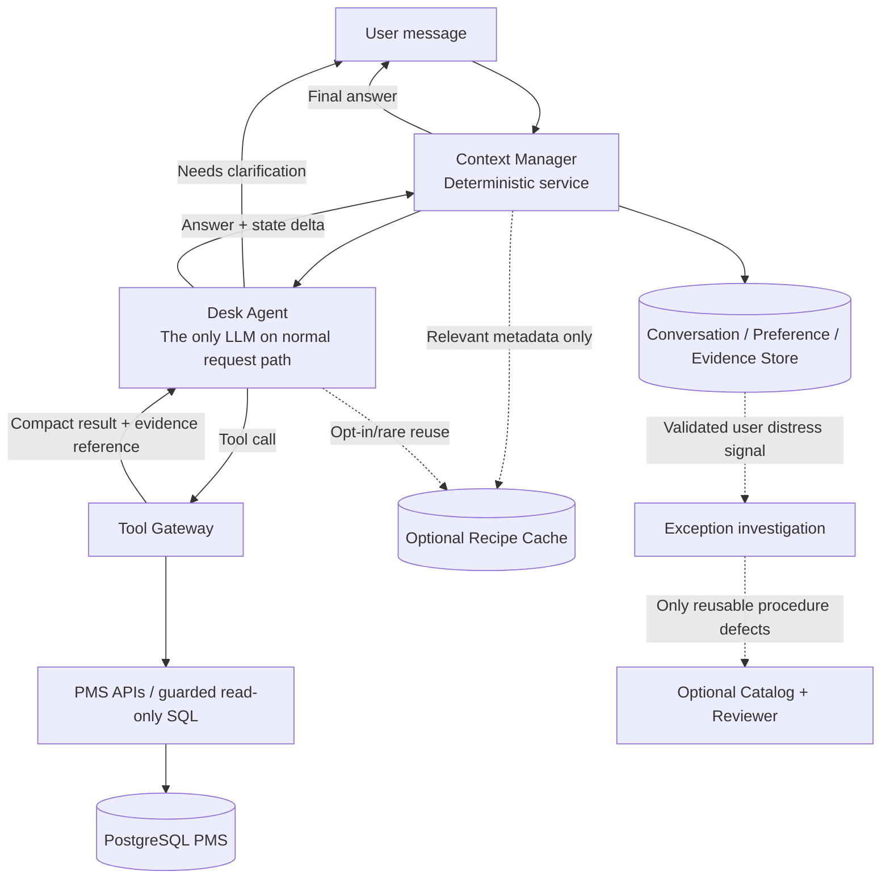
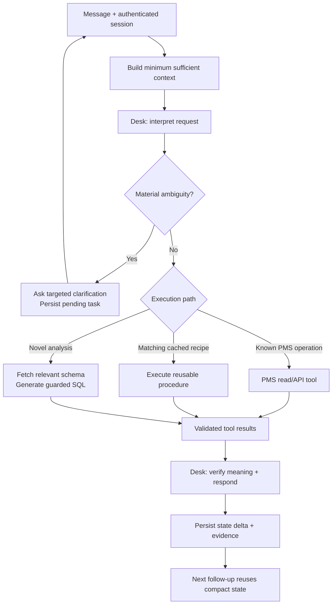

# LEON — Minimal Context Manager & End-to-End Workflow

**Architecture specification · Version 1.0 · 1 November 2026**

## 1. Executive decision

**LEON is a capable conversational Desk Agent with access to PMS tools and hotel data. The Context Manager exists to give it the *minimum sufficient context* for each turn.** We are optimizing cost, response latency, and continuity—not attempting to manufacture reasoning ability through additional agents.

> **Preserve the user's meaning. Supply only the context needed. Let Desk solve the problem.**

### Non-goals

- No mandatory Catalog Agent, Reviewer Agent, or recipe-publication workflow in the normal response path.
- No requirement to classify every question into a fixed report template.
- No automatic new recipe merely because a question is unfamiliar, complex, or requires SQL.
- No keyword-only simplification that removes conditions, time boundaries, references, or business meaning.
- No repeated loading of the full conversation history, full database schema, or full recipe bodies.
- No extra LLM solely for building context by default.

### Scope

The existing PMS remains the source of truth for reservations, room inventory, guests, payments, rates, and operations. LEON adds conversational interpretation and access to existing PMS APIs plus strictly guarded read-only SQL for analysis. The architecture supports ad hoc reports and **user-specific reusable report procedures** without restricting requests to a predefined reporting engine.

---

## 2. System architecture



**Just four essential runtime parts:**

1. **Desk Agent (LLM):** understand, clarify, reason, plan, call tools, and answer.
2. **Context Manager (code):** maintain dialogue state, resolve safe deterministic references, select and compact relevant context, and persist state changes.
3. **Tool Gateway (code):** discover/fetch data, execute authorized PMS operations, and enforce safeguards.
4. **Persistent stores:** conversation transcript, active task state, confirmed user preferences, schema metadata cache, prior results, and tool/evidence traces.

Recipes are a *cache or reusable procedure*, not an additional intelligence layer. Catalog and Reviewer, if retained, are out-of-band maintenance components.

---

## 3. Context Manager: one responsibility

**For this message, what is the smallest complete context that lets Desk interpret and solve the request correctly?**

The Context Manager is not another LLM and does not independently decide the answer, write SQL, infer business policy, or trigger a Catalog job. It selects and organizes context for the Desk Agent. Think of it as a **context compiler** rather than a knowledge-authoring service.

### 3.1 Context sources and retrieval policy

| Source | When included | What to include | What to avoid |
|---|---|---|---|
| Current message | Always | Original exact user text | Lossy keyword rewrite |
| Active conversation state | Always if a task is open | Intent, entities, filters, comparison, unresolved references, pending question | Entire previous transcript |
| Recent turns | Small bounded window | Turns necessary to interpret follow-ups/corrections | Arbitrary long history |
| User-specific definitions | When relevant to current phrase or request | Confirmed meaning, scope, last confirmation, version | All user preferences |
| Hotel/session scope | Always for data operations | Authorized hotel IDs, timezone, current local date, permissions | Model-selected hotel or tenant IDs |
| PMS schema | When query construction requires it | Relevant tables, columns, FK relationships, business caveats | Complete schema catalog |
| Recipe metadata | Only if a matching reusable method helps | Name, intent, input/output contract, version | Full SQL body by default |
| Prior results | When referenced, compared, or refined | Report definition, result summary, result ID | Large result rows in prompt |
| Historical messages | Only for meaningful unresolved references | Narrow retrieved excerpt with provenance | Automatically feeding every prior chat |
| Tool evidence | Only for current calculation/verification | Query ID, timestamps, row counts, compact aggregate | Full SQL logs or irrelevant traces |

**Priority:** meaning and correctness first; then token economy. If a shortened context cannot reliably preserve a restriction or reference, include the original supporting turn.

### 3.2 Two layers of context

**Durable context (stored, not automatically prompted):** full conversation messages, user-confirmed preferences and report definitions, previous report specs/results, SQL execution traces, tool errors, and schema descriptions.

**Working context (sent to the LLM this turn):** current user message, compact active-task state, the few relevant earlier turns, matching user definitions, scope/permissions, and—only when necessary—relevant schema or procedure descriptions.

Durable storage is cheap relative to repeatedly sending everything to the model. Never overwrite the original transcript with a lossy summary; summaries are indices or working views, not the sole record.

### 3.3 Active task state (not a generated recipe)

```json
{
  "conversation_id": "c_501",
  "active_task_id": "t_108",
  "status": "ready",
  "intent": "analytical_report",
  "hotel_scope": ["hotel_12"],
  "timezone": "Asia/Kuala_Lumpur",
  "report": {
    "metrics": ["room_revenue", "booking_count"],
    "dimensions": ["ota_channel"],
    "period": {"start": "2026-10-01", "end_exclusive": "2026-11-01"},
    "filters": [{"field": "booking_status", "op": "eq", "value": "confirmed"}]
  },
  "pending_clarification": null,
  "previous_result_id": "result_929",
  "confirmed_by_user": ["metrics", "dimensions"],
  "last_updated_turn": 9
}
```

The representation is deliberately small. **The Desk interprets the utterance; Context Manager stores and merges the resulting explicit state delta** (after deterministic validation). No separate model is needed to restate the entire conversation.

### 3.4 Relative dates and reference resolution

- Resolve `today`, `yesterday`, `tomorrow`, and date ranges using **hotel-local timezone and current clock**, not a date assumed by the model.
- `yesterday` on **1 November 2026** in Malaysia means **31 October 2026**. Do not ask the user to confirm this by default; it is a deterministic date calculation.
- Clarify only when meaning remains materially ambiguous: *“yesterday's report”* may refer to sales, bookings, or a user's named report.
- Preserve distinctions: booking count vs room count vs guest headcount; booked revenue vs recognized revenue; check-in date vs reservation-created date.
- A phrase such as *“What about last week?”* updates the time range of the **active task** while retaining other confirmed filters/metrics, unless context indicates otherwise.
- **Do not silently invent** a definition for *“arrivals”* or *“net sales”*. Use an existing confirmed definition or ask a focused clarification when the difference affects the answer.
- Convert dates into explicit, well-defined query intervals (usually start inclusive, end exclusive) and retain the original phrase for auditability.

### 3.5 Clarification as normal operation

Clarification is not a failed request and never triggers Catalog by itself.

```text
User: Show me yesterday's report.
LEON: Which report—sales and bookings, or another report?
User: Sales and bookings.
LEON: [executes for 31 Oct 2026]
User: Break it down by OTA.
LEON: [same metrics/date/hotel; adds OTA dimension]
User: Save that as my daily report.
LEON: [stores a user-specific procedure after confirmation]
```

While awaiting an answer, store the pending question and partial task. Short replies like *“sales and bookings”*, *“yes”*, or *“only Booking.com”* modify that existing task; they are not treated as unrelated new requests.

### 3.6 User-specific definitions and personal recipes

Store a **confirmed** mapping between a user's phrase and its intended meaning when the user explicitly requests it, confirms it, or clearly establishes an ongoing preference. Avoid making permanent assumptions from a one-off report variation.

```json
{
  "owner_user_id": "u_123",
  "name": "daily_report",
  "aliases": ["my morning report", "yesterday's report"],
  "procedure": {
    "metrics": ["room_revenue", "booking_count"],
    "period": "yesterday_at_execution_time",
    "dimensions": [],
    "output": "short_summary"
  },
  "scope": "user_private",
  "version": 3,
  "confirmed": true
}
```

A personal recipe is a **saved user workflow**, not a reason to involve Catalog/Reviewer. Relative dates are resolved when invoked; user permissions and hotel scope are checked each time. One-off changes must not silently edit the saved definition.

---

## 4. Context construction: practical algorithm

A compact, deterministic-first approach:

```python
def build_context(message, session):
    scope = authorize_scope(session.user_id, session.hotel_ids)
    local_time = now_in_timezone(session.hotel_timezone)

    task = load_active_task(session.conversation_id)
    recent = select_relevant_recent_turns(session.conversation_id, task)
    preferences = find_confirmed_user_definitions(
        session.user_id, message, task
    )
    references = fetch_referenced_result_summaries(message, task)

    return ContextPacket(
        original_message=message,
        current_local_time=local_time,
        authorized_scope=scope,
        active_task=task,
        relevant_turns=recent,
        confirmed_definitions=preferences,
        referenced_results=references,
        available_tools=tool_descriptions_for(scope),
    )
```

**Avoid a second reasoning model in `build_context()`.** Where purely lexical lookup fails to locate a relevant prior definition, the Desk can request additional context via a retrieval tool. This is progressive disclosure rather than speculative retrieval of everything.

### Context budget (starting guideline, not a hard accuracy constraint)

- Small stable system instructions + relevant tool descriptions.
- One current user message, never paraphrased away.
- One compact active-task object.
- Last few *relevant* turns, increased when resolving a correction or pronoun.
- Only matching personal definitions and references.
- Schema details only after a question requires database structure.
- Compact tool results, with pagination/IDs for drill-down.

**Overflow policy:** drop irrelevant history and oversized result rows first; do not drop user-negated conditions, exceptions, time qualifications, hotel scope, or the pending clarification. If necessary, use an additional targeted retrieval call.

### Context updates

After each Desk turn, save a validated **state delta** rather than asking the LLM to regenerate the entire conversation state:

```json
{
  "task_id": "t_108",
  "changes": {
    "report.dimensions": ["ota_channel"],
    "report.period": {"start": "2026-10-26", "end_exclusive": "2026-11-02"}
  },
  "source_turn_id": 10,
  "operation": "replace_period_preserve_other_filters"
}
```

State updates should use optimistic version checks to avoid concurrent chat/device writes. Maintain traceable provenance (which message established each important assumption).

---

## 5. Entire runtime workflow

### Phase A — Understand the request

1. **Receive message** with authenticated user, hotel scope, conversation ID, and local time.
2. **Load compact state** and relevant prior references; preserve the message verbatim.
3. **Desk resolves the user's intended question.** Deterministic date references are supplied by code; user-specific definitions and pending clarifications are applied.
4. **If materially incomplete**, Desk asks *one focused question* and stores `status=awaiting_clarification`. The request stops here until the next user turn.
5. **If complete**, Desk proceeds. No Catalog involvement merely because the question is novel.

### Phase B — Obtain data / do the work

6. **Prefer existing PMS read APIs** when their outputs directly satisfy the request.
7. **For an ordinary analytical question**, use an approved cached procedure if genuinely compatible, or generate a safe ad hoc SQL query from relevant schema details. Recipes are optional shortcuts—not mandatory definitions or report templates.
8. **For a user-specific saved report**, load the saved procedure, apply current parameters, and execute. For one-off variations, adapt this execution without overwriting the saved recipe.
9. **Validate tool access and execution:** enforce authenticated scope, read-only SQL restrictions, bound parameters, timeouts, and row/result limits at the tool/database boundary. The model's SQL is untrusted input.
10. **Receive compact results** with source and execution metadata; request more detail only if required for the answer.

### Phase C — Answer and remember

11. **Desk checks alignment:** Did the answer preserve the user's metric, date, grouping, filters, and unit? A successful query does *not* prove the business interpretation is correct.
12. **Answer directly** with appropriate units, date range, and uncertainty if necessary. Do not claim causation from correlations or incomplete data.
13. **Persist:** original user message, assistant message, state delta, relevant tool evidence, result ID, and any explicitly confirmed preference.
14. **For the next turn**, reuse active task + compact references rather than replaying every SQL query and transcript entry.



### Phase D — Exceptions (outside the standard request path)

- **User expresses distress:** *“That's not what I asked,” “You keep getting this wrong,” “I told you before.”* Desk should first correct or clarify the live task.
- Log a dissatisfaction signal with relevant turns/tool traces; distinguish *context/memory*, *business-definition*, *data*, *execution*, *UX*, and *reusable-procedure* problems.
- **Catalog investigation occurs only when user distress is plausibly linked to a reusable procedural deficiency**, not merely because Desk was uncertain or used ad hoc SQL. This investigation should not block the user-facing reply.
- A Reviewer, if retained, evaluates proposed shared procedure changes **outside the synchronous Desk path**.
- **Critical safety/correctness exceptions:** independently quarantine a proven unsafe or broken tool/recipe even without a complaint. This is an operational safety response, not a Catalog-learning trigger.

---

## 6. Tools: keep the interface small

Recommended core interfaces (illustrative names, not new LLM agents):

```text
get_pms_data(resource, filters, fields, pagination)
get_schema_context(tables_or_business_concepts)
run_readonly_sql(sql, bound_parameters)
get_previous_result(result_id, selection)
find_personal_recipe(user_id, intent_or_alias)
execute_recipe(recipe_id, parameter_values)   # optional optimization
save_personal_recipe(definition)              # confirmed user request only
```

Existing transactional PMS APIs handle modifications with explicit permissions and confirmations where needed. Do not route booking changes, payment changes, or room assignments through an unrestricted SQL tool.

**Security principles:** enforce tenant isolation server-side; do not trust model-supplied hotel IDs; use database-level read-only rights and where possible scoped data access; inspect parsed SQL rather than only regex; use parameter binding; restrict accessible schemas and functions; cap execution time, result size, and query cost; log query lineage; block DDL/DML and unsafe functions. A model-written query can be valid SQL and still answer the wrong business question.

---

## 7. Recipe policy — optional speed optimization

The full recipe body is **not** loaded into every LLM turn. The same principle applies to dedicated tool implementations: code stays outside model context wherever possible.

| Case | Default behavior | Catalog? |
|---|---|---|
| Familiar occupancy report | Use small relevant tool contract or cached execution | No |
| Unusual occupancy filter | Adapt query with relevant schema | No |
| Personalized morning report | Execute saved user procedure | No |
| New one-off multi-source report | Desk plans and executes | No |
| Incomplete “yesterday's report” | Clarify / apply confirmed personal definition | No |
| Verified reusable recipe causes recurring user dissatisfaction | Desk repairs live request; investigate underlying method separately | Possibly |
| Unsafe procedure discovered | Quarantine immediately, independently of Catalog | Safety response |

**Recipe ≠ context.** A recipe is optional reusable execution knowledge. User meaning, corrections, pending clarifications, and current task state belong in conversation context. Neither should be used as a substitute for the other.

---

## 8. Example: conversational reporting without catalog calls

| Turn | Message | Context/operation |
|---|---|---|
| 1 | “Show me yesterday's report.” | Resolve 31 Oct 2026; report type ambiguous unless personal preference exists |
| 2 | LEON asks: “Which report?” | Store pending question, date, hotel scope |
| 3 | “Sales and number of bookings.” | Complete prior task; select data tools; execute |
| 4 | “Break it down by OTA.” | Preserve date and metrics; add dimension; query again |
| 5 | “What about last week?” | Preserve metrics, OTA breakdown, and filters; replace period |
| 6 | “Save this as my weekly report.” | Confirm/save private recipe with dynamic time range; no Catalog |
| 7 | “The number looks wrong; I meant checked-in bookings, not bookings made.” | Correct metric/date basis, fix current answer, update definition only with consent; record distress reason if appropriate |

The full transcript is retained as evidence, but on turn 5 the Desk needs only the active task definition, the newest message, the resolved period, and perhaps one supporting turn. It need not read the whole conversation or all prior SQL.

---

## 9. Performance model and benchmarks

Optimize the **total cost and latency of a correct request**, not the smallest prompt at any price:

```text
Total latency ≈ context retrieval + model processing + tool calls + database work + final answer
Total tokens  ≈ stable instructions + active context + relevant tools + schema/recipe disclosure + results + output
```

**Key optimization levers (measure rather than assume):**

1. **Remove needless LLM hops.** No Catalog/Reviewer in normal response path.
2. **Avoid prompt bloat.** Compact task state and relevant history instead of full transcript.
3. **Progressively disclose data.** Fetch schema/recipe details only when the current task requires them.
4. **Cache metadata and reusable procedures.** Do not repeatedly inspect unchanged schema for common requests.
5. **Reduce unnecessary tool round trips.** Choose direct PMS tools for known operations; batch compatible safe reads when practical.
6. **Use efficient database queries.** A bad query can overwhelm any prompt-token savings.
7. **Preserve correctness.** More clarification may make one interaction longer but avoid costly wrong answers and rework.

### Telemetry (per turn)

```json
{
  "turn_id": "turn_501_10",
  "context_input_tokens": 2250,
  "output_tokens": 190,
  "llm_calls": 2,
  "tool_calls": 1,
  "context_build_ms": 28,
  "end_to_end_ms": 1800,
  "clarification_requested": false,
  "context_retrieval_miss": false,
  "user_correction_within_3_turns": false,
  "catalog_triggered": false
}
```

*Numbers above are illustrative instrumentation examples, not measured LEON performance.* Measure median and p95 latency, input/output tokens, tool calls, successful resolution, user corrections, needless clarifications, wrong-scope answers, and report correctness separately.

### Acceptance tests

1. “Yesterday” resolves to the correct hotel-local date without unnecessary confirmation.
2. An ambiguous report type yields one clarification, not guessed SQL.
3. A brief clarification reply completes the pending task.
4. “What about last week?” retains the prior report's metrics, grouping, and hotel scope.
5. “Only Booking.com” adds a filter instead of replacing the report.
6. Guest headcount is not silently substituted with reservation or room count.
7. A user-specific “morning report” runs without loading unrelated user preferences.
8. A one-time change does not silently rewrite a saved personal recipe.
9. An unfamiliar question can be solved using read-only SQL without Catalog.
10. Full-schema and full-history loading are absent in ordinary traces.
11. Cross-hotel SQL access is blocked even if model-generated SQL requests it.
12. A user complaint prompts live repair; only a confirmed procedural issue can create a Catalog investigation.
13. Repeated execution produces results consistent with the same business definition and source data.
14. Context compression never discards essential negations, date bases, or comparison periods.

---

## 10. Minimal build order

**Stage 1 — Make conversation correct:** session scope, task state, pending clarification, compact recent context, deterministic relative dates, basic state persistence.

**Stage 2 — Connect tools safely:** existing PMS APIs, schema lookup, scoped read-only SQL, compact result references, audit logs.

**Stage 3 — Optimize measurable bottlenecks:** schema caching, tool metadata retrieval, token budgeting, SQL/report result reuse; *then* consider recipe execution caching for repeated, stable work.

**Stage 4 — Personalize:** confirmed user definitions and saved personal reports; preserve history and version preferences.

**Stage 5 — Optional exception process:** distress signals, root-cause diagnostics, and rare Catalog/Reviewer work for proven reusable procedural issues.

### Explicit decision gate for extra architecture

**Do not add a new agent, router, semantic engine, or recipe-approval step unless measured data demonstrates a material gain in correctness, response speed, token cost, or safety that cannot be obtained with a simpler change.**

---

## Final principle

> **LEON's intelligence is the Desk Agent. Its speed comes from delivering only the context and tools needed for the user's current intent. Its reliability comes from preserving meaning, asking targeted clarifications, and enforcing execution safeguards. Recipes are optional optimization artifacts—not the center of the system.**
