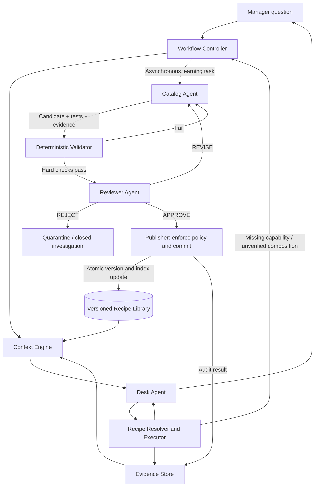

# LEON — Reviewer Agent and Autonomous Recipe Publication Workflow

**Architecture specification | 31 October 2026**

## 1. Purpose

LEON uses three LLM agents: **Desk Agent** (low reasoning, user-facing problem solver), **Catalog Agent** (high reasoning, develops reusable problem-solving recipes), and **Reviewer Agent** (high reasoning, independently evaluates proposed recipes). A deterministic **Workflow Controller**, **Context Engine**, **Recipe Resolver/Executor**, **Validator**, **Publisher**, **Evidence Store**, and **Knowledge Library** support them.

The Reviewer Agent makes autonomous library growth possible without requiring human review for each safe, read-only recipe. It is an independent critic, **not** the SQL executor, publisher, or source of business policy. Approval is conditional on mandatory deterministic checks; agreement between two LLMs alone does not prove correctness.

## 2. End-to-end architecture



The Context Engine **supplies context**; it does not approve publication. The Workflow Controller **routes events and enforces retry limits**; it does not decide whether a recipe is semantically correct. The Publisher **enforces hard policy and commits**; it never trusts an LLM decision without checking the validated proposal identity and evidence.

## 3. Responsibilities and authority

| Component | Responsibilities | Must not do |
|---|---|---|
| Desk Agent (LLM, low reasoning) | Preserve original question meaning; decompose into answerable subproblems; use existing recipes; combine 2–3 compatible results; synthesize answer; escalate uncertainty | Invent unverified joins, silently substitute bookings for guests, publish recipes |
| Catalog Agent (LLM, high reasoning) | Investigate gaps; inspect relevant schema and recipes; develop complete procedures; write SQL/composition; define tests; propose revision or new recipe | Approve its own proposal, alter hotel data, deploy DDL |
| Reviewer Agent (LLM, high reasoning) | Independently test the proposed method against original intent, business definitions, schema, result semantics, composition contracts and evidence; issue APPROVE/REVISE/REJECT | Execute arbitrary untrusted SQL, bypass validator, modify proposal while approving, publish directly |
| Context Engine (Python) | Assemble role-specific, bounded context packages from immutable references; persist investigation state | Make semantic approval decisions |
| Deterministic Validator (Python) | SQL read-only safety; hotel isolation; schema/parameter/output checks; dependency/version compatibility; fixture and regression execution; policy checks | Claim complete semantic correctness from SQL success alone |
| Publisher (Python) | Check authorization and validator status; transactional version/index publication; audit and rollback support | Publish a rejected or stale proposal |
| Workflow Controller (Python) | Trigger tasks, enforce idempotency, budgets, revision limits, asynchronous learning | Repeatedly trigger identical investigations |

## 4. What is a recipe?

A **recipe is a complete, reusable method for solving a problem**, not a list of relevant tables or SQL fragments. It must describe:

- **Meaning:** question class, business metric definitions, hotel/date scope, exclusions, assumptions and unsupported cases.
- **Inputs:** typed parameters, defaults and validation constraints.
- **Procedure:** ordered executable steps; precise SQL or references to validated subrecipes; dependency and parameter mapping; join keys; filters; aggregation rules; null/missing-data behavior.
- **Outputs:** typed result schema, cardinality, units, provenance and how the Desk Agent should interpret the result.
- **Evidence and tests:** independent fixtures, expected outputs, boundary cases, execution trace and dependency versions.

**Atomic recipe:** solves one reusable capability. **Composite recipe:** defines an executable multi-step solution, possibly compiled into a single optimized read-only SELECT/CTE when appropriate. A recipe that only names ingredients is incomplete and must be rejected.

## 5. Trigger paths

### 5.1 Fast answer path

1. Manager asks a question; controller creates a scoped request event.
2. Context Engine supplies original wording, authorized hotel scope, relevant conversation context, and recipe summaries/contracts.
3. Desk Agent preserves all conditions and selects a known recipe or decomposes into 2–3 answerable subproblems.
4. Recipe Resolver retrieves full matching recipe bodies; Executor runs validated operations under read-only, tenant-scoped access.
5. Desk Agent combines compatible outputs and answers with clear limitations. It must not infer facts absent from the data.
6. Evidence Store saves selected recipe IDs/versions, parameters, result metadata and any uncertainty.

**Do not wait for Catalog Agent or Reviewer Agent to publish before answering a question that can already be solved reliably.**

### 5.2 Autonomous learning path

Eligible events include `recipe_not_found`, `successful_ad_hoc_composition`, `recipe_execution_defect`, `semantic_mismatch`, and `composition_gap`. Not every unusual question requires permanent publication.

1. Controller deduplicates by canonical problem signature, hotel-independent capability, and active investigation state.
2. Catalog Agent receives a compact context package: original question, meaning-preserving decomposition, relevant recipes, successful/failed execution evidence, and selectively expanded schema.
3. Catalog Agent proposes a **complete** atomic/composite recipe, or repairs an existing one; it includes independent tests and expected outputs.
4. Deterministic Validator runs hard safety, compatibility and regression checks.
5. Reviewer Agent receives an **independent review package** and returns structured verdict.
6. For `REVISE`, Catalog Agent receives actionable findings; maximum two revision cycles by default. For `REJECT`, quarantine with evidence. For `APPROVE`, Publisher rechecks policy and atomically publishes version and index changes.
7. Future Desk requests retrieve and reuse the published recipe.

### 5.3 Publication is not always justified

A rare one-off composition can be answered and recorded without creating a new library entry. Publish when the method is correct, generalizable, sufficiently distinct from existing recipes, and valuable to reuse. Repair aliases/index metadata when the recipe already exists but retrieval failed.

## 6. Reviewer Agent inputs: independent review package

The reviewer should see the **original user question**, not just the Catalog Agent's simplified restatement. It should also receive the proposed recipe, approved business definitions, relevant schema contracts, independent execution evidence, and validation reports. Avoid flooding the reviewer with the Catalog Agent's entire chain of reasoning, which can anchor its judgment.

```json
{
  "review_id": "REV-142",
  "proposal_id": 142,
  "proposal_version_hash": "sha256:...",
  "original_question": "Which guests arriving tomorrow have previously complained?",
  "hotel_scope": "authorized_hotel_id",
  "canonical_problem": {
    "entity": "guest",
    "conditions": ["arrival tomorrow", "complaint during a prior stay"],
    "output": "distinct guest list"
  },
  "recipe_ref": "candidate:142",
  "business_definition_refs": ["metric:guest_identity:v3"],
  "schema_refs": ["schema:reservations:v12", "schema:complaints:v4"],
  "validator_report_ref": "validation:142",
  "test_evidence_refs": ["fixture:142-1", "regression:142-2"],
  "related_recipe_refs": ["recipe:arrivals:v2"]
}
```

All refs are immutable snapshots or version-pinned. The review must fail closed if required evidence is missing or the proposal changes after review.

## 7. Reviewer checklist

1. **Meaning preservation:** Every user constraint is retained; no unsupported assumptions; correct time boundaries and hotel scope.
2. **Metric semantics:** Guests ≠ reservations ≠ rooms; booking date ≠ stay date; confirmed ≠ checked-in; missing records ≠ zero.
3. **Complete procedure:** Inputs, executable steps, joins, ordering, output transformation and exception handling are explicit; no hidden reasoning left for Desk Agent.
4. **Correct composition:** Join keys are stable; join cardinality and grain are correct; no duplicate counting; aggregate-to-detail joins are justified; dependency outputs match inputs.
5. **SQL and safety:** Read-only, parameterized, tenant-isolated; relevant permissions; no unsafe dynamic SQL. Hard safety is enforced independently by Validator.
6. **Evidence:** Independent tests cover expected outputs, empty results, duplicates, NULLs, boundary dates, and representative cases. A query merely returning rows does not establish correctness.
7. **Reusability:** Does not duplicate an existing recipe; parameterizes hotel/date/status; appropriate atomic vs composite scope.
8. **Operational impact:** Dependencies pinned; reasonable latency and query cost; rollback path exists.
9. **Business authority:** If a required definition is absent or contested, mark unresolved. The reviewer must not invent policy.

## 8. Reviewer verdict contract

```json
{
  "review_id": "REV-142",
  "proposal_id": 142,
  "proposal_version_hash": "sha256:...",
  "decision": "REVISE",
  "confidence": "high",
  "findings": [
    {
      "severity": "critical",
      "category": "semantic_mismatch",
      "evidence_ref": "validation:142",
      "issue": "The procedure counts reservations instead of distinct guests.",
      "required_fix": "Use verified guest identity and count distinct guest IDs."
    }
  ],
  "unresolved_questions": [],
  "reviewed_dependency_versions": ["recipe:arrivals:v2"]
}
```

Allowed decisions:

- **APPROVE:** Complete, meaning-preserving, supported by required evidence, no unresolved critical findings.
- **REVISE:** Repairable defect; precise required changes and evidence references.
- **REJECT:** Fundamentally unsafe, incorrect, unsupported, redundant, or not publishable under policy.

A fourth internal workflow status, **BLOCKED**, may be used by the controller for missing data, missing approved definitions, unavailable test environments, or exhausted revision budget; it is not a reviewer approval.

## 9. Publication policy

| Change | Path |
|---|---|
| Alias/index metadata correction | Deterministic checks; may auto-publish without LLM review |
| New or modified read-only atomic recipe | Validator PASS → Reviewer APPROVE → Publisher |
| New or modified composite recipe | Validator PASS → Reviewer APPROVE → Publisher |
| Change to approved business definition | Block until an authorized definition is available; Reviewer cannot invent authority |
| Schema migration or operational write | Out of scope for autonomous recipe publisher; separate privileged change process |
| Unverified results, missing facts, failed safety checks | Do not publish |

The Publisher verifies `proposal_version_hash`, all required validation reports, review decision, dependency versions, and current publication policy in a single transaction. It writes the new version, active pointer, searchable index and audit event atomically. Roll back by restoring a prior validated version, not by silently rewriting history.

## 10. Failure and loop controls

- One active investigation per deduplicated capability; repeated questions attach evidence to the same task.
- Maximum two Catalog ↔ Reviewer revisions per proposal by default; stop and preserve evidence afterward.
- Explicit per-step and end-to-end budgets; do not let learning block Desk responses.
- A reviewer rejection must not automatically spawn a fresh identical proposal.
- If review evidence is stale, invalidate approval and rerun relevant tests.
- Treat timeouts, missing hotel data and permission failures separately from catalog defects.
- Record why a candidate was not published so subsequent investigations do not repeat it blindly.

## 11. Suggested persistent entities

- `workflow_events`: event ID, type, correlation ID, deduplication key, timestamp.
- `investigations`: problem signature, status, current proposal, attempt/revision count.
- `recipe_proposals`: candidate body, base recipe/version, immutable content hash.
- `validation_runs`: validator version, input hash, checks, fixtures, results.
- `recipe_reviews`: reviewer model/version, verdict, findings, evidence refs, input hash.
- `recipe_versions`: immutable published recipe body, dependencies, semantic contracts.
- `recipe_active_versions`: active version pointer.
- `knowledge_index`: discoverability metadata, indexed description and capability signature.
- `execution_evidence`: request, SQL/recipe references, parameters, results, errors and provenance.
- `publication_audit`: decision, validation/review IDs, actor/service, commit/rollback.

Use existing tables where they already provide these functions; this is a logical schema, not an instruction to recreate your database.

## 12. Acceptance tests

1. A new valid read-only reservation-count recipe passes validation, reviewer approval, and atomic publication.
2. A candidate counting bookings when asked for guests is returned `REVISE` with a semantic defect.
3. A composite recipe lists ingredients but omits join logic; reviewer rejects it as incomplete.
4. A valid composite recipe correctly joins by guest ID and hotel ID with date constraints.
5. A candidate with unsafe SQL is blocked before reviewer approval can publish it.
6. A proposal changing after approval fails hash/version checks at publication.
7. Two simultaneous identical knowledge-gap events create one investigation.
8. A repeated rejected proposal does not cause an infinite loop.
9. A rare question can be answered by Desk composition before any new recipe is published.
10. A published recipe becomes retrievable by meaning and its complete execution contract, not just keyphrases.
11. Missing inventory records are not silently interpreted as zero inventory.
12. An absent business definition blocks publication rather than being invented by either agent.

## 13. Implementation order

1. Define immutable recipe proposal and review verdict schemas.
2. Add independent validator and fixture harness; ensure read-only, hotel-scoped execution.
3. Add reviewer context package builder and one-shot Reviewer Agent call.
4. Add Controller state transitions, revision budgets and idempotency.
5. Add Publisher authorization checks and atomic version/index update.
6. Integrate background learning events from Desk composition and Query execution.
7. Measure review precision, false approvals, revision rate, publication throughput, retrieval reuse, and latency.

## 14. Governing principle

**Desk solves the user's problem. Catalog writes a complete reusable method. Reviewer independently challenges the method. Validator enforces executable constraints. Publisher commits only an approved, validated, version-pinned recipe. Context Engine supplies each participant the evidence it needs.**

Autonomy is the goal, but the system must be able to say **not proven** rather than publish an attractive but incorrect recipe.
