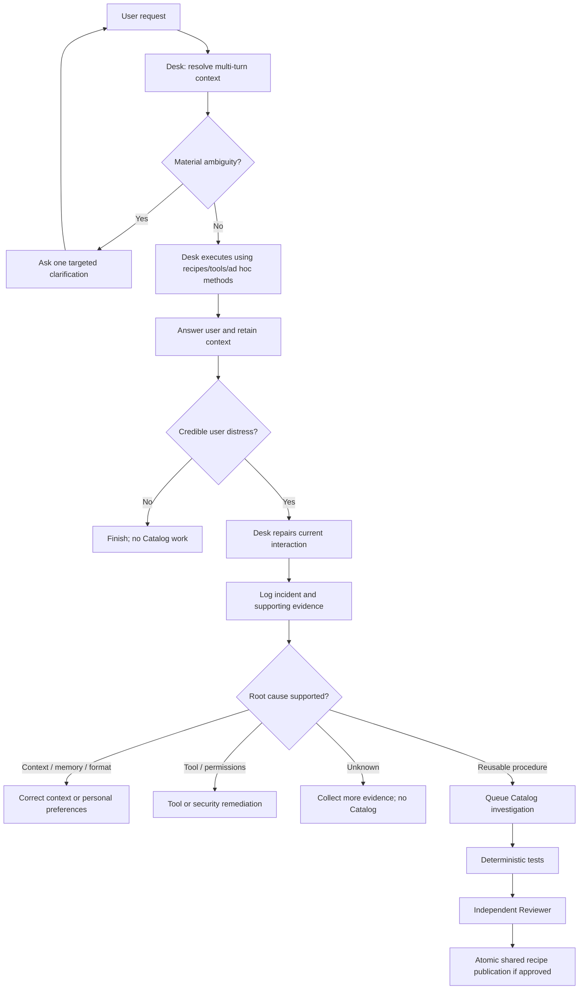

# LEON — User-Distress-Driven Catalog Agent

**Architecture specification · 1 November 2026**  
**Status:** Proposed operating policy for implementation  
**Core principle:** **Desk solves the user's problem. Catalog addresses recurring dissatisfaction attributable to a reusable procedural weakness.**

---

## 1. Decision

LEON's **Catalog Agent must not be triggered by the Desk Agent's difficulty, uncertainty, unfamiliar questions, complex SQL, missing recipes, or use of multiple tools.** Those are ordinary aspects of a capable assistant's work.

The primary *learning/investigation* trigger is **evidence of user distress**: an interaction in which the user communicates that LEON has misunderstood, failed, repeated a mistake, or imposed unnecessary effort.

**Important separation:** User distress triggers **diagnosis**, *not automatically Catalog execution*. Only an investigated, evidence-backed **reusable-procedure problem** should be routed to Catalog. Many complaints are better solved by correcting conversational context, remembering a user-specific definition, or improving the current reply.

The system should aim for the **Desk Agent to resolve ≥95% of user requests without Catalog involvement**. This is an engineering target, not a measured result, and must never be achieved by suppressing complaints or sacrificing answer correctness.

## 2. Agent responsibilities

### Desk Agent (primary, user-facing)

- Understand full conversational intent and retain meaning over multiple turns.
- Resolve dates, hotel scope, references to previous reports, and previously confirmed preferences.
- Ask a targeted clarification **only when the ambiguity changes the answer**.
- Use existing recipes, combine methods, generate safe ad hoc read-only queries, and use PMS tools.
- Correct mistakes immediately when users complain; do not defer the response to Catalog.
- Save or update **user-specific** report definitions/preferences with appropriate user confirmation; avoid confusing one-off variations with lasting preferences.
- Capture evidence of distress and of what was done to recover the interaction.
- **Never trigger Catalog merely because it found the task hard.**

### Distress Monitor / Routing Policy (lightweight infrastructure, not an additional LLM agent)

- Examine conversational feedback and task outcomes for credible distress indicators.
- Open a diagnostic incident when a credible signal is present.
- Classify whether the problem is contextual, personal-memory-related, procedural, tool/system-related, permissions-related, or uncertain.
- Deduplicate related incidents; record user impact and recovery outcome.
- Route to Catalog **only if the evidence supports a reusable procedural deficiency**.
- Route correctness/security incidents to independent safety controls even without complaints.

### Catalog Agent (rare, non-user-facing)

- Investigate **only routed, evidence-backed reusable procedural gaps**.
- Determine whether an existing shared recipe is defective or a general reusable method is missing.
- Create or repair a complete executable method: inputs, scope, dependencies, parameter mapping, SQL/API operations, ordering, expected output, edge cases, and verification tests.
- Offer a proposed change and its tests; **do not self-publish**.
- Remain out of the active user conversation unless the product deliberately exposes a later resolution notice.

### Reviewer Agent + deterministic validation (only on proposed shared publication)

- Reviewer independently examines original user intent, incident evidence, proposed method, business semantics, and test results.
- Deterministic validation enforces read-only SQL, tenant boundaries, parameter safety, schema compatibility, output contracts, and regression checks.
- Publisher atomically versions/publishes only an approved and validated shared method.
- No automatic schema migrations or privileged actions are authorized by recipe publication.

## 3. Distress signals

| Signal | Example | Interpretation | Default action |
|---|---|---|---|
| Explicit rejection | “That's not what I asked.” | Strong evidence the answer did not meet intent | Desk corrects; open incident |
| Repeated correction | “No, I said *guest headcount*, not bookings.” | User must restate intent | Desk corrects; open or update incident |
| Complaint about repetition | “Why do I have to explain this every time?” | Memory/context problem is likely | Investigate user context or saved definitions |
| Complaint about report correctness | “You keep calculating occupancy incorrectly.” | Potential procedural/business-semantics defect | Inspect evidence, then possibly Catalog |
| Explicit dissatisfaction | “This report is useless.” | Result didn't match user's need | Clarify defect; classify cause |
| User abandons task | User stops replying after a failed result | **Weak, ambiguous signal**—may have unrelated cause | Log as weak telemetry, **do not infer distress or trigger Catalog by itself** |
| New/difficult question | Novel multi-table query | Not evidence of dissatisfaction | Desk handles normally |
| Desk uncertainty | Low model confidence or failed initial SQL | Internal difficulty, not user distress | Desk recovers or asks for context |
| Clarification request | “Which report do you mean?” | Normal conversational workflow | No incident unless excessive/repeated and user objects |
| One-time customization | “Group that report by OTA instead.” | Normal user preference | Desk handles directly |

**Design rule:** Detect feedback about **outcome and friction**, not merely the user's emotional tone. Sarcasm, short replies, language style, or frustration unrelated to LEON are not reliable grounds for escalating to Catalog. Explicit user feedback is stronger evidence than sentiment classifiers.

## 4. Failure classification: diagnose before routing

| Failure class | Typical symptom | Correct owner | Catalog? |
|---|---|---|---|
| `missing_context` | Date or hotel not established | Desk / conversation state | **No** |
| `ambiguous_intent` | “Report” could mean several things | Desk clarification | **No** |
| `memory_failure` | LEON forgot what “my daily report” means | Desk / user memory store | **No** |
| `wrong_reference` | “Same report” points to wrong prior report | Desk / context resolver | **No** |
| `presentation_mismatch` | Correct data but wrong format or detail | Desk / saved preferences | **No** |
| `one_off_customization` | User wants a unique report layout | Desk | **No** |
| `reusable_procedure_defect` | Standard shared calculation demonstrably wrong | Catalog | **Yes, after diagnosis** |
| `missing_reusable_method` | Repeated dissatisfaction attributable to absent shared procedure | Catalog | **Yes, after diagnosis** |
| `temporary_tool_error` | API timeout, transient database outage | Tool/ops recovery | **No** |
| `permissions_or_policy` | User is not authorized to view data | Authorization / security | **No** |
| `unknown_cause` | Insufficient evidence | Desk recovery + telemetry | **Not yet** |

**Prevent a common misdiagnosis:** A user saying “I already told you what yesterday's report means” indicates a *memory/definition* failure, not a missing SQL recipe. Creating a new Catalog recipe would fix the wrong layer.

## 5. Routing workflow



### Operational rules

1. **Recover first:** Desk should try to satisfy the user in the same interaction instead of telling them a background agent will fix the problem.
2. **No Desk self-escalation:** Desk cannot submit a Catalog task based on its own difficulty; its evidence goes through the routing policy.
3. **Evidence, not emotion alone:** A credible complaint opens an incident, but Catalog routing requires a procedural diagnosis.
4. **Asynchronous by default:** Catalog work must not block routine Desk answers. If a request cannot safely be completed now, Desk should say so plainly.
5. **No catalog inflation:** Similar complaints should be grouped by the *underlying resolved capability and root cause*, not string similarity.
6. **Maintain safety independently:** A confirmed serious data-integrity, authorization, or correctness issue can disable a dangerous method immediately without awaiting user distress. This is an **exceptional safety/control path**, not a routine Catalog learning trigger.

## 6. Sample conversations

### Example A — Contextual ambiguity, no Catalog

**User:** “Send me yesterday's report.”  
**LEON:** “Do you mean your sales and booking-count report for 31 October 2026?”  
**User:** “Yes.”  
**LEON:** Executes the report using established definitions.

**Result:** No distress, no Catalog invocation. `yesterday` is calculated using the hotel's timezone. If “sales and booking-count report” was *not* previously established, LEON should ask which report is meant rather than inventing a preference.

### Example B — User distress caused by memory failure, no Catalog

**User:** “Yesterday's report.”  
**LEON:** “Which report?”  
**User:** “I told you before—sales and number of bookings! Why do you keep asking?”

**Diagnosis:** User-specific definition not recalled.  
**Immediate Desk repair:** Apologize briefly, use the clarified definition, execute the report.  
**Durable fix:** Persist or correct the user's definition of “yesterday's report,” subject to user-memory rules.  
**Catalog:** **Not invoked.**

### Example C — Genuine procedural defect, Catalog eligible

**User:** “This occupancy report is wrong again. It counts out-of-order rooms as sellable.”

**Desk:** Correct the answer if possible using verified room-status data, explain the discrepancy without overstating certainty, and log evidence.  
**Diagnosis:** The shared `sellable_room_count` procedure appears to omit a material inventory exclusion.  
**Catalog:** Investigate and propose a corrected shared method with tests for out-of-order, blocked, sold, and other inventory states.  
**Reviewer and safety gate:** Verify the methodology and publish after approval. If the known shared method is demonstrably unsafe or misleading, quarantine it independently while investigating.

### Example D — Hard question, no Catalog

**User:** “Compare net revenue by OTA for returning guests who booked within 48 hours of arrival, grouped by weekday.”

**Desk:** Preserve the entire set of conditions, inspect available metadata, join relevant tables, run safe read-only queries and return an evidence-grounded result, or clarify a material ambiguity.  
**Catalog:** **Not invoked** merely because the computation is complex or novel.

## 7. Minimal data contracts

### Distress incident

```json
{
  "incident_id": "inc_123",
  "conversation_id": "conv_456",
  "user_id": "user_789",
  "hotel_id": "hotel_001",
  "source": "explicit_user_feedback",
  "signal": "repeated_correction",
  "user_feedback": "I told you before what this report means",
  "resolved_request": {
    "intent": "generate_report",
    "report_definition": "daily_sales_and_booking_count",
    "report_date": "2026-10-31"
  },
  "diagnosis": "memory_failure",
  "diagnosis_evidence": ["previous_confirmed_user_definition_missing_from_current_context"],
  "desk_recovery_status": "corrected_in_current_turn",
  "catalog_eligible": false,
  "status": "closed_after_context_repair"
}
```

### Catalog task (only after classification)

```json
{
  "task_id": "cat_123",
  "trigger_type": "user_distress_with_verified_procedural_root_cause",
  "incident_ids": ["inc_100", "inc_117"],
  "capability": "sellable_room_count",
  "defect": "out_of_order_rooms_not_excluded",
  "original_user_intent": "rooms actually sellable for tonight",
  "evidence_refs": ["query_run_100", "inventory_snapshot_117"],
  "expected_deliverable": "validated_reusable_recipe_revision",
  "status": "queued"
}
```

These are **illustrative contracts**, not verified schemas. Minimize stored user text where possible, enforce tenant isolation and retention policies, and avoid leaking guest data into investigation contexts.

## 8. Reference trigger policy

```python
from enum import Enum

class Cause(str, Enum):
    CONTEXT = "missing_context"
    AMBIGUITY = "ambiguous_intent"
    MEMORY = "memory_failure"
    PRESENTATION = "presentation_mismatch"
    TOOL = "temporary_tool_error"
    PERMISSION = "permissions_or_policy"
    PROCEDURE_DEFECT = "reusable_procedure_defect"
    MISSING_SHARED_METHOD = "missing_reusable_method"
    UNKNOWN = "unknown_cause"

CATALOG_CAUSES = {
    Cause.PROCEDURE_DEFECT,
    Cause.MISSING_SHARED_METHOD,
}


def open_distress_incident(event) -> bool:
    # Reliable user-outcome feedback, not Desk uncertainty.
    return event.explicit_user_complaint or event.repeated_user_correction


def enqueue_catalog(incident) -> bool:
    # Run only AFTER incident review/classification and evidence collection.
    return (
        incident.user_distress_supported
        and incident.root_cause in CATALOG_CAUSES
        and incident.procedural_evidence_verified
        and incident.reusable_across_requests
        and not incident.duplicate_active_catalog_task
    )
```

**Critical safeguard:** The classification fields are not unquestionable LLM assertions. Require supporting evidence, such as the original resolved question, actual executed method, result, correction, approved business definition, and a reproducible test. Ambiguous cases remain `unknown_cause` and do not become shared recipes.

## 9. Observability and success criteria

Track both the user's experience and whether escalation targets the right root cause:

| Metric | Meaning |
|---|---|
| **Desk-only completion rate** | Share of requests completed without Catalog involvement; aspiration ≥95% |
| **User correction rate** | Share of interactions requiring “No, that's not what I meant”-type repair |
| **Repeated-explanation rate** | Share requiring the user to restate a previously confirmed personal definition |
| **Distress recovery rate** | Share of evidenced complaints resolved by Desk in the current conversation |
| **Catalog routing precision** | Share of Catalog investigations ultimately verified as reusable procedural weaknesses |
| **Publication regression rate** | Share of new shared methods that fail later validation or require rollback |
| **Repeat-distress rate** | Whether the *same diagnosed issue* frustrates users again after remediation |

**Do not use complaint suppression as success.** Track correctness using verified test questions and audit samples as well as user feedback. Some users do not complain even when an answer is wrong.

## 10. Acceptance tests

1. New complex question, correctly answered → **Desk only**.
2. Desk asks a justified first clarification → **no incident, no Catalog**.
3. User replies with clarification → **same task state continues**.
4. “That's not what I asked” after wrong metric → **Desk repairs; incident recorded**.
5. User complains about a forgotten report preference → **memory correction; no Catalog**.
6. User changes a report format for one request → **Desk handles; saved recipe unchanged**.
7. User explicitly saves a personal report definition → **Desk/personal store; no shared Catalog publication**.
8. Tool timeout followed by a user complaint → **ops recovery, not Catalog**.
9. Reproducible shared calculation defect + user complaint → **Catalog investigation**.
10. Catalog proposal fails SQL safety/tenant checks → **publication blocked regardless of Reviewer decision**.
11. User silent after an answer → **not treated as proven distress**.
12. A confirmed high-risk shared procedure defect, even without complaint → **immediate independent quarantine/safety workflow**.

---

## Implementation priority

**Phase 1 — Build conversational reliability:** Multi-turn task state, reference/date resolution, targeted clarifications, personal definitions, safe Desk execution.

**Phase 2 — Capture user-experience failures:** Distress signals, incident evidence, immediate Desk recovery, deterministic routing and root-cause categorization.

**Phase 3 — Enable rare Catalog remediation:** Only verified reusable-procedure incidents reach Catalog; Reviewer and validation gate remain solely in the publication path.

### Final operating policy

> **Distress opens an investigation; evidence chooses the repair.**  
> **Desk owns the conversation and immediate recovery.**  
> **Catalog owns only reusable procedural remediation.**  
> **Reviewer and validators protect shared publication.**
