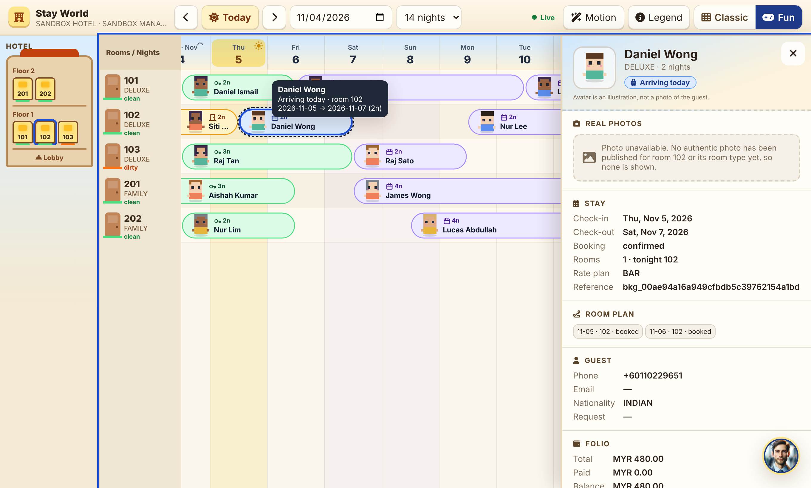
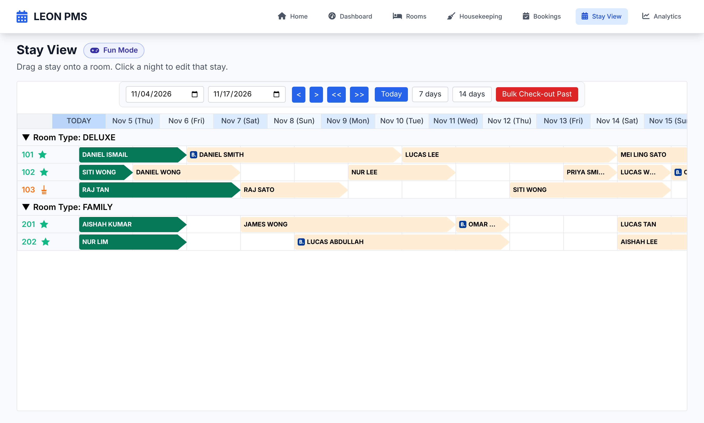
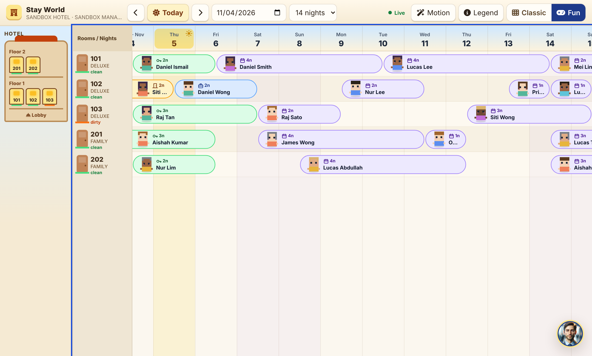
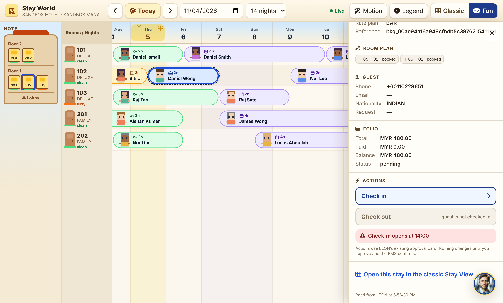
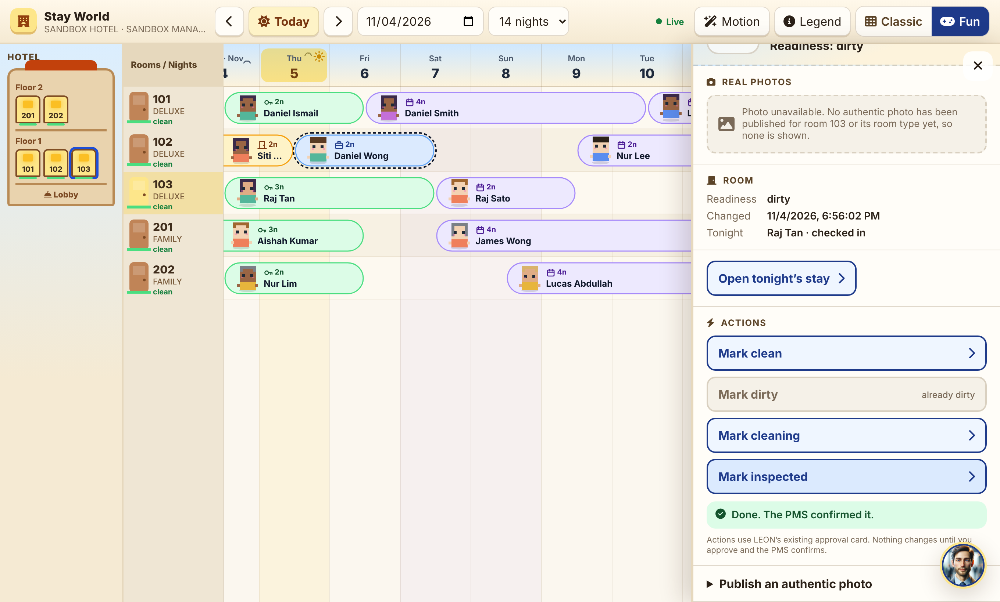
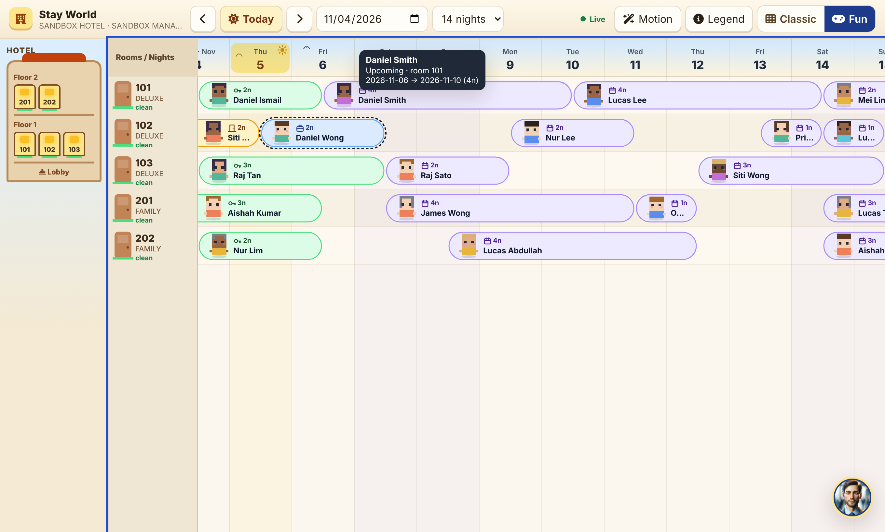
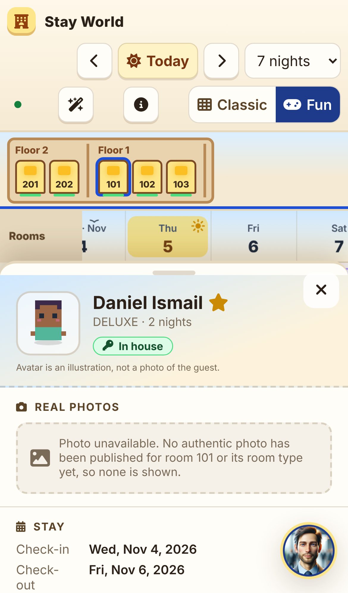

# LEON World Mode (Fun Mode): P1 Stay Calendar World

An optional, illustrated view of the **same** Stay View data and actions. It is a presentation layer: reads go through the existing
desk services, writes go through the existing action recipes and approval card, and nothing in the PMS changes until a person approves
and the PMS confirms.

> Glance = game · Touch = reality · Confirm = action

See [`repo-audit.md`](repo-audit.md) for what exists and why World Mode is a web page in the PMS UI for P1.



## What P1 does

| Definition of Done | How |
|---|---|
| 1. Open the PMS and switch into Fun Mode | The classic Stay View (`assignments.html`) shows a **Fun Mode** chip when World Mode is on. It keeps the dates. |
| 2. Illustrated, responsive, lightly animated calendar with real PMS data | `world.html` draws rooms × hotel-local nights on a Canvas. Stays are pills from the afternoon of the first night to the morning of check-out, with an illustrative pixel avatar, a state icon and a word, the night count and a group marker. Also: out-of-order hatching, an unassigned-nights lane, room doors with readiness mats, and a floor/building selector. Ambient effects are blinking and bobbing avatars, a glow on today, and birds in the sky strip. |
| 3. Select a reservation → panel with authentic media or a truthful no-photo state | Tapping a stay bounces it at once, and a side panel (a bottom sheet on phones) loads `/api/world/reservations/{id}/presentation`. Photos are hotel-uploaded and authentic, and are labelled "This room" or "Example of room type X". Otherwise the panel says *Photo unavailable*. |
| 4. Return without losing context | Close, Escape or browser Back closes the panel. The camera, dates and zoom stay where they were. The URL carries `start`, `span`, `booking` and `room`. |
| 5. Review an operational action through the established approval | Check in, Check out (reservation), Mark clean/dirty/cleaning/inspected (room). `POST /api/world/actions/prepare` calls `action_recipe.prepare_action` and shows LEON's approval card. Approve and Cancel call the existing `/api/leon/actions/{id}/approve|reject`. |
| 6. The world updates only after the server reports the real outcome | After approval the client re-reads the calendar, then shows the outcome. A sparkle plays **only** on `approved` + `ok`. `failed`, `expired`, rejected and network errors show their text, and nothing is celebrated. |
| 7. Switch back with no regression | The **Classic** button opens `assignments.html?start=&end=`. The classic page is unchanged apart from one script tag. |

Interaction: tap selects. Hold (480 ms) peeks without selecting. Dragging pans and never selects or acts. Pinch or ctrl+wheel zooms
(44–180 px per night). In the canvas, arrow keys move between stays, Enter opens one, and + and − zoom. A Motion toggle reduces
animation and follows `prefers-reduced-motion`. Animation pauses while the tab is hidden. The LEON advisor (bottom right) never opens
by itself: its badge counts warnings, and its tips come from the calendar data by fixed rules (room not ready for an arrival, due-outs,
late arrivals, unassigned nights), not from a model.

## API (all behind the access guard; the hotel always comes from the session)

| Route | Access | Notes |
|---|---|---|
| `GET /api/world/config` | front_desk.view | `enabled`, the reason when off, hotel today, and capability flags from the person's module levels |
| `GET /api/world/calendar?start_date&end_date` | front_desk.view | rooms (floor, readiness), stays (spans), blocks, unassigned. At most 62 nights. Guest names become initials without reservations.view |
| `GET /api/world/reservations/{booking_id}/presentation?stay_date` | front_desk.view | dates, status, room plan, guest (contact needs reservations.view), folio (needs reservations.view or finance.view), media, action intents with reasons |
| `GET /api/world/rooms/{room}/presentation` | front_desk.view | readiness, tonight's stay, media, readiness intents |
| `GET /api/world/media[?binding_kind&binding_ref]`, `GET /api/world/media/{id}?variant=thumb\|full` | front_desk.view | private, hotel-scoped bytes (`Cache-Control: private`) |
| `POST /api/world/media` (multipart: `binding_kind` room\|room_type\|facility, `binding_ref`, `photo`, optional `thumb`, `caption`, `authentic=true`) | admin.manage | type from magic bytes, size from the header. JPEG/PNG/WebP only, ≤ 4 MB, ≤ 4096 px. The uploader must attest the photo is authentic |
| `POST /api/world/media/{id}/retire` | admin.manage | |
| `GET /api/world/manifest?scene=` | front_desk.view | active scene revision. A stored revision that no longer validates is refused (`stale`) |
| `POST /api/world/scenes` (manifest JSON), `POST /api/world/scenes/{id}/rollback` | admin.manage | validated, immutable revisions with an atomic active pointer |
| `POST /api/world/actions/prepare` `{intent, booking_id?, room_number?, new_status?}` | front_desk.view (the recipe's own permission is checked again inside `prepare_action`) | intents: `check_in` → `reservation_check_in`, `check_out` → `reservation_check_out`, `set_readiness` → `room_set_readiness`. Returns the pending card plus `approve_path` and `reject_path` |

Every error is `{state, error}` with `state` one of `error`, `not_found`, `forbidden`, `refused`, `disabled` or `stale`. The
client adds `offline`. Media returns `no_photo` when there is nothing to show.

The scene manifest contract (`booking_system/world/manifest.py`, schema_version 1) is declarative only: no unknown fields, ids and
asset ids from a fixed alphabet, labels without markup or template characters, bounds and polygons inside the coordinate space,
`allowed_action_keys` from a fixed list (presentation intents, not grants), and media references to `wmd_…` ids only. P1 publishes
and validates manifests. The illustrated hotel scene that renders them is P2.

## Feature flag

World Mode is on only when **both** of these hold:

1. On the server, `WORLD_MODE_ENABLED=1` (or `all` for development, which turns it on for every hotel). It defaults to off.
2. With `1`, the hotel setting `front_desk.world_mode` is `true` (set through `POST /api/settings` by an admin.manage user).

When off, `/api/world/config` reports why, every other world route answers 409 `disabled`, and the classic view shows no switch.

## Local setup

```bash
# LEON: Postgres 16 on :5433 (any local Postgres works)
export DATABASE_URL=postgresql://postgres@localhost:5433/leon   # set it explicitly: a DATABASE_URL already in the environment wins over .env
export JWT_SECRET=local-dev-secret CM_SERVICE_SECRET=x LEON_PLATFORM_ADMIN_TOKEN=x
pip install -r requirements.txt pytest
python -c "from setup_schema import setup_schema; setup_schema()"
python -m fixtures.sandbox seed
python -c "from booking_system.semantic.registry import initialize_catalog; initialize_catalog(); \
from booking_system.semantic.seed_general import seed; print(seed(['reservation_check_in','reservation_check_out','room_set_readiness','housekeeping_create_task']))"
WORLD_MODE_ENABLED=all python main.py          # API on :8002
```

```bash
# LEON_UI
python3 -m http.server 8080                    # open http://localhost:8080/login.html, sign in as sandbox_manager / sandbox-pass-2026
```

Open **Stay View → Fun Mode**, or go to `http://localhost:8080/world.html`. On a fresh sandbox, check-in and check-out are refused
until the hotel's front-desk settings (check-in time and others) are answered through `/api/settings`. That refusal is the PMS's,
and World Mode shows it as a failure.

## Tests and what actually ran

| Suite | Command | Result here |
|---|---|---|
| Backend, pure (spans, manifest, photo checks, flags, intents, redaction) | `python -m pytest tests/world -q` | 38 passed |
| Backend, integration against the running server and local DB (classic ↔ world agreement, hotel isolation, housekeeping redaction, reject changes nothing, approve runs once, PMS refusal reported as failed, media authenticity and isolation, manifest publish/validate/rollback) | `LEON_WORLD_IT=1 DATABASE_URL=…localhost… JWT_SECRET=… python -m pytest tests/world -q` | 47 passed (pure + 9 integration) |
| UI, pure core (dates across months/years and DST, geometry, hit tests, culling of 5,000 stays, zoom, gestures, outcomes, advisor, diff) | `npm test` in LEON_UI | 12 passed |
| UI, browser end to end (Chromium via Playwright, desktop and iPhone 13 emulation) | `npm run test:e2e` in LEON_UI | 14/14 steps passed; screenshots in `screenshots/` |

Indicative performance (headless Chromium in a container, **not** a device profile): about 60 fps rAF with ambient motion, and about
1.1 s from page load to the first calendar render against the local API. Real Android and iOS device profiling has **not** been done:
there are no devices or emulators in this environment.

## Screenshots

| | |
|---|---|
|  Classic view with the Fun Mode switch |  Stay World |
|  Approved check-in **refused by the PMS** ("Check-in opens at 14:00"), shown as a failure |  Readiness change confirmed by the PMS, then celebrated |
|  Long-press peek |  Phone bottom sheet |

## Known gaps and next steps (P2)

* **Medium mode** does not exist yet. "Light" is today's classic Stay View, and Fun Mode is the only new mode.
* No room has an authentic photo in the sandbox, so the screenshots show the truthful *Photo unavailable* state. The photo path is
  covered by the integration test, with a synthetic image that is retired afterwards.
* There is a minimal upload form in the room panel for admins. A proper media library (crop, reorder, review queue, object storage
  with signed URLs) is still to do.
* Live updates are 60-second polling plus a refresh on focus or when the network comes back. Add events if the desk needs faster
  updates.
* P2: one illustrated hotel scene rendered from the published manifest, with 4–6 hotspots bound to rooms and facilities, hold-and-drag
  photo discovery (the gesture tracker already separates pan, peek and tap), and the advisor sprite in-scene.
* Flutter/Flame client: consume the same `/api/world/*` contracts and port `world-core.js`. The rules are covered by its tests.
* The cached thumbnails live only in memory as object URLs and are cleared on a hotel switch or sign-out. A native client must define
  its own on-disk policy.
